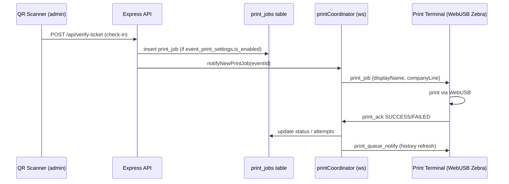

# Print Coordinator (WebSocket badge printing)

`server/print/printCoordinator.ts` — coordinates Zebra badge printing between the server and browser-based print terminals (`/admin/print-terminal`, WebUSB).

## Flow

## Protocol
- Terminal connects with `?token=<JWT>&eventId=<id>` query params; token verified with `JWT_SECRET`.
- Client state per socket: `ready`, `busy`, `currentJobId`.
- Incoming messages: `printer_ready`, `printer_offline`, `print_ack {job_id, status, error_code?, message?}`.
- Jobs are **claimed** (locked by `locked_by_socket_id`) so multiple terminals don't double-print.
- Failure: attempts incremented, max 3; `last_error_code`/`last_error_message` stored.
- Guarantee: `print_job` message is dispatched **before** `print_queue_notify` so the browser sees the job before the history refresh ping.
- Keep-alive: `server/print/wsHeartbeat.ts` pings every terminal every 20 s and terminates one that missed the previous pong (its `close` handler requeues the claimed job). Without traffic, nginx's default 60 s `proxy_read_timeout` (or a venue NAT) dropped idle terminals.
- Reconnect: `AdminPrintTerminalPage` reconnects forever with a 1 s → 10 s backoff and re-sends `printer_ready` on open. It stops only on unmount, an event change, or close codes 4000/4001/4002 (bad token / not admin), which show a "Sessão expirada" toast.

## Label layout (`client/src/lib/zebraZpl.ts`)
Every flow (queue, reprint, manual) goes through `printBadgeLabel`: first + last name, company upper-cased (pt-BR). Each field is one `^FB` line whose square `^A0` font shrinks to fit 600 dots (name ≤ 100/110 dots, company ≤ 70); a company that would drop under 40 dots wraps to 2 lines instead. The company `^FO` sits below the fitted name height. Before 2026-10-15 the name block allowed 2 lines and the company assumed 1, so "Mariana Albuquerque" overprinted the company. Check layout changes by rendering the ZPL at labelary.com (8 dpmm, 3.15 × 1.77 in) with fake names.

## Windows terminals need WinUSB
On Windows, Chrome's WebUSB fails `open()` ("Failed to execute 'open' on 'USBDevice': Access denied") while the Zebra uses its Windows printer driver. Swap it to WinUSB with Zadig (Options → List All Devices → USB ID `0A5F` → WinUSB → Replace Driver), then replug. That PC then prints to the Zebra only through the browser; undo by uninstalling the device with its driver in Device Manager. macOS needs no change.

## Related tables
`print_jobs`, `event_print_settings` — see [[40-Database/Schema-Overview]].

## Printing is off per event until someone turns it on
`storage.getEventPrintSetting` returns `isEnabled: false` when the event has no `event_print_settings` row, so a check-in queues **no** label unless the admin switched on **"Impressão no credenciamento"** on the event's edit page (`PATCH /api/admin/events/:eventId/print-settings`). Check it before every in-person event.

As of 2026-10-13 (prod aggregate read), the 2026-10-20 event had no row and `print_jobs` held 0 rows for any event, ever: printing had never queued a label in production. The owner's dry run (scan one test ticket, print one label) is what proves the scanner → `print_jobs` → terminal → Zebra path; see `70-Operations/Prompt-Dry-Run-Then-Fixes.md`.
